# iqmq

<p align="center">
  
</p>

<p align="center">
A bytes-first Go API for publishing and consuming messages across Kafka,
NATS/JetStream, NSQ, Google Cloud Pub/Sub, Amazon SQS, SNS+SQS, RabbitMQ,
ActiveMQ, Redis Streams and Pulsar, with explicit broker capabilities.
A deterministic in-process memory driver provides the canonical test double.
</p>

<p align="center">
  <a href="https://github.com/iqhive/iqmq/actions/workflows/ci.yml"></a>
  <a href="https://github.com/iqhive/iqmq/releases"></a>
  <a href="https://pkg.go.dev/github.com/iqhive/iqmq"></a>
  <a href="https://github.com/iqhive/iqmq/actions/workflows/ci.yml"></a>
  <a href="https://github.com/iqhive/iqmq/actions/workflows/fuzz.yml"></a>
  <a href="docs/performance/index.md"></a>
  <a href="https://goreportcard.com/report/github.com/iqhive/iqmq"></a>
  <a href="https://scorecard.dev/viewer/?uri=github.com/iqhive/iqmq"></a>
  <a href="LICENSE"></a>
</p>

## Install

```sh
go get github.com/iqhive/iqmq                    # Core, standard library only
go get github.com/iqhive/iqmq/drivers/kafka      # Add the driver you need
```

The core and memory driver depend only on the Go standard library. Each
broker driver is a separate module and brings only its own client library.
A Kafka application does not need to compile the AWS SDK.

Core minor releases follow a release train: every official module is tagged
together. Patch releases are independent.

See the [installation guide](docs/getting-started/installation.md) for the
full list of modules and DSN schemes.

## Quick start

No broker or container required. The memory driver uses the same `Backend`
interface, runner and settlement state machine as the broker drivers.

```go
ctx := context.Background()
client, err := memory.Open(ctx, memory.Config{AutoCreate: true})
if err != nil {
    panic(err)
}
defer func() { _ = client.Shutdown(ctx) }()

consumer, err := client.Consumer(ctx, mq.ConsumerConfig{Topic: "orders", Subscription: "billing"})
if err != nil {
    panic(err)
}
handled := make(chan struct{})
go func() {
    _ = consumer.Run(ctx, mq.HandlerFunc(func(_ context.Context, d *mq.Delivery) error {
        fmt.Printf("order %s: %s\n", d.Key, d.Body)
        close(handled)
        return nil // ack
    }), mq.WithConcurrency(8), mq.WithOrderingByKey())
}()

if err := client.Publish(ctx, "orders", &mq.Message{Key: []byte("cust-42"), Body: []byte(`{"id":1}`)}); err != nil {
    panic(err)
}
<-handled
// Output: order cust-42: {"id":1}
```

This snippet comes from `Example` in `example_test.go`. Go compiles the example
and checks its expected output during `go test`.

`memory.Open` is the only driver-specific call. Replacing it with
`dsn.Open(ctx, "kafka://…")` changes the driver, but it does not make broker
semantics interchangeable. Check
[capability negotiation](docs/concepts/capabilities.md) before relying on
delivery, ordering or durability behaviour.

## Why iqmq

- **Shared policy across brokers.** Retries, backoff, attempt counting,
  dead-lettering, lease extension, ordering and graceful drain are implemented
  in the core rather than repeated in each application or driver. Measured
  abstraction overhead is published, including results that exceed the
  specification's budgets.

- **Explicit capabilities.** A five-level typed model is generated from
  conformance evidence. Unsupported requests fail at construction or before
  I/O with `ErrUnsupported`, rather than falling back to an emulation you did
  not choose. Unprobed capabilities remain distinguishable from verified ones.

- **Bytes-first messages.** `Message.Body` is `[]byte`. Headers are ordered
  and binary-capable, and codecs are optional. Hot paths use no reflection.
  Every hot path has an `AllocsPerRun` test asserting its exact allocation
  count, with no per-message allocation in steady state.

- **Separate driver modules.** You depend on the broker SDK you choose.
  A check enforces the standard-library-only dependency boundary for the
  root module and memory driver.

- **A test double built on the production runner.** `memory.NewForTest(t)`
  provides a fake clock, fault injection and a goroutine-leak check over the
  same engine used by the driver runners. With `testing/synctest`, tests can
  assert when a retry happens, not only whether it eventually succeeds.

## Guarantees and limits

### Guaranteed behaviour

These guarantees are covered by per-driver conformance probes, including
failure paths.

- **At-least-once delivery by default.** Settlement is explicit. Generation
  tokens prevent a stale handle from settling a newer delivery, and only one
  concurrent terminal settlement attempt can win.

- **Confirmed dead-letter publication before acknowledgement.** The core
  publishes to the destination, confirms the publication, then acknowledges
  the original. A refused or ambiguous dead-letter publication requeues the
  original and is counted. It does not acknowledge the original.

- **Bounded buffers.** Every buffer has a default bound, with no setting that
  disables it. A model fuzzer asserts the resulting memory plateau after
  every step.

- **Explicit unknown states.** Ambiguous publishes, ambiguous settlements
  and unadvertised limits each have their own representation.

- **Errors exclude sensitive contents.** Errors do not carry payloads,
  keys, header values, credentials or addresses.

### Not guaranteed

- **Exactly-once processing.** This layer does not provide it.
  Broker-scoped exactly-once delivery is reported as a capability. Application
  side effects still need an idempotent handler or an inbox table.

- **Global ordering.** Ordering has a declared scope and requires four
  conditions to hold. See [Ordering](docs/concepts/ordering.md).

- **Duplicate-free delivery.** A process can die after the handler returns
  but before the acknowledgement reaches the broker. At-least-once delivery
  permits redelivery in that window.

- **Durability from volatile emulation.** `EmulatedVolatile` does not satisfy
  a durability requirement. `ConfirmDurable` fails at construction for
  profiles without a meaningful durable boundary, including NATS Core and
  the memory engine.

- **Compliance with every performance budget.** Current measurements exceed
  some of the specification's budgets. See [Performance](#performance).

## Architecture

<p align="center">
  
</p>

Policy belongs in the core, not in drivers. If both layers own redelivery
accounting, a message can be retried 25 times when the application asked for
five.

A driver implements three interfaces. Broker-specific behaviour is exposed
through optional interfaces, which the core checks once when opening the
driver, not on the per-message path.

### Settlement flow

<p align="center">
  
</p>

The diagram follows the runner's implementation. Four details affect failure
handling:

- `Halt` stops fetching before requeuing.
- A dead-letter directive without a destination halts rather than dropping
  the message.
- Dead-letter publication is confirmed before the original is acknowledged.
- With relaxed ordering on a broker that does not track delivery counts, the
  attempt bound cannot be reached. A failing message continues to retry.

## Drivers

Every driver has a maturity level and maintenance tier. The
[selection guide](docs/drivers/index.md) compares them, and each
[driver page](docs/drivers/) follows the same 15-section structure.

Capabilities are available through the client API. Run conformance tests
against your broker and configuration before relying on a capability.

<!-- matrix:start -->
<!-- matrix:end -->

## Performance

Benchmarks are provisional. Batched overhead exceeds the specification's
budget in 10 of the 12 measured rows.

Run the core benchmarks with:

```sh
go test -run=^$ -bench=. -benchmem ./...
```

See the [performance documentation](docs/performance/index.md) and
[benchmark methodology](docs/performance/methodology.md) for driver and
native-client comparisons.

## Concepts

| Guide | What it explains |
|---|---|
| [Architecture](docs/concepts/architecture.md) | Where application calls go and which layer owns policy |
| [Delivery guarantees](docs/concepts/delivery-guarantees.md) | What an acknowledgement means and what it does not |
| [Duplicates and idempotency](docs/concepts/idempotency.md) | Where duplicates come from and how to handle them |
| [Ordering](docs/concepts/ordering.md) | The four ordering conditions and what breaks them |
| [Acks and leases](docs/concepts/acks-and-leases.md) | What happens between receipt and settlement |
| [Groups and subscriptions](docs/concepts/subscriptions.md) | Which consumers receive which messages |
| [Backpressure](docs/concepts/backpressure.md) | What happens when a producer outruns a broker |
| [Confirmation boundaries](docs/concepts/confirmation.md) | What a `nil` return from `Publish` means |
| [Ambiguous publishes](docs/concepts/ambiguous-publishes.md) | What happens when the publish outcome is unknown |
| [Metadata modes](docs/concepts/metadata-modes.md) | How headers work with brokers that do not support them |
| [Capability negotiation](docs/concepts/capabilities.md) | How to determine what a broker supports |

## Observability

Observability is opt-in through hooks, stats snapshots and 26 error codes.
Observation points have no cost when unset. There is no package-level logger
or `init()`-time side effect.

```go
client := mq.NewClient(backend, mq.WithHooks(m.Hooks()))
consumer.Run(ctx, handler, mq.WithMiddleware(middleware.Metrics(m.Recorder(), nil)))
```

- **[Metrics](docs/operations/metrics.md):** `integrations/prometheus`
  provides the canonical metric names used by dashboards.
- **[Tracing](docs/operations/tracing.md):** `integrations/otel` provides
  four spans, histograms and gauges, with W3C trace context carried in
  message headers.
- **Operations:** See [Logging](docs/operations/logging.md),
  [Health](docs/operations/health.md),
  [Capacity](docs/operations/capacity.md) and
  [Troubleshooting](docs/operations/troubleshooting.md).

The specification has no shutdown hook, so a drain that exceeds its timeout
is not exposed as a metric.

## Testing and fuzzing

### Memory driver

`memory.NewForTest(t)` enables `AutoCreate`, installs a fake clock and
registers a goroutine-leak check through `t.Cleanup`. It uses the same engine,
runner and settlement state machine as the production driver runners.

Its capability table is generated by a conformance run, as it is for every
other driver.

### Deterministic timing

Use `broker.Advance(d)` with the fake clock to drive delayed delivery, TTL,
lease expiry and retry backoff without sleeping.

With `testing/synctest`, tests can assert the retry schedule:

```go
func TestChargeWorkflowInABubble(t *testing.T) {
    const base = time.Hour
    synctest.Test(t, func(t *testing.T) {
        client, broker := memory.NewForTest(t, memory.TestRealClock())
        if err := broker.Advance(time.Second); err == nil {
            t.Fatal("Advance succeeded on a broker left on the wall clock")
        }
        start := time.Now()
        runWorkflow(t, client, base)
        // Two failures at a doubling backoff based at an hour: exactly three
        // hours of bubble time. A runner that stopped waiting, capped the
        // delay, or drew it from a jitter envelope would change this number
        // and nothing else in the test.
        if got, want := time.Since(start), base+2*base; got != want {
            t.Errorf("took %v of bubble time, want exactly %v", got, want)
        }
    })
}
```

### Fault injection

`broker.Faults()` can reject the nth publication, fail a settlement, force a
duplicate, expire leases or fail a dead-letter publication.

Every fault has a counter. A counter of zero tells you the test did not
reach the failure path it was intended to exercise.

### Fuzzing

The repository has 130 fuzz targets. A ratchet prevents that count from
falling and requires a target in every package that parses input or holds
state.

`make fuzz-seeds` runs every committed input under `-race` in every CI run,
so previously discovered failures remain part of regression coverage.

Differential targets run a fuzzer-generated operation script against both
the implementation and a reference oracle, comparing state after every step.

[Testing](docs/testing/index.md) ·
[synctest](docs/testing/synctest.md) ·
[testkit](docs/testing/testkit.md) ·
[Conformance](docs/testing/conformance.md) ·
[Fuzzing](docs/testing/fuzzing.md)

## Compatibility and versioning

iqmq follows SemVer:

- During `v0.x`, the API may change. Breaking changes are announced and
  accompanied by migration notes.
- From `v1.0`, the root package and SPI are stable. New functionality is
  added through optional interfaces and concrete handles, rather than
  adding methods to existing public interfaces.
- Deprecations remain for at least two minor releases and use `Deprecated:`
  markers.
- Minimum Go version increases happen only in minor releases and are
  announced.

`make apidiff` compares the public API against a committed baseline so
changes are detected before release.

## Security

Broker payloads are untrusted. Limits are enforced before allocation, wire
envelope auto-detection requires explicit configuration, and every
asynchronous and retry buffer is bounded.

Each driver's `Config` redacts credentials through `String`, `GoString`,
`LogValue` and `DSN`. Tests exercise this through a real `log/slog` handler.
Errors must not contain payloads, keys, header values, credentials or
addresses.

TLS is enabled by default for remote profiles. Any option that disables it
has `Insecure` in its name. Contradictory TLS settings are rejected at
construction.

Report vulnerabilities through
[GitHub private vulnerability reporting](https://github.com/iqhive/iqmq/security/advisories/new).
See the [security guide](docs/security/index.md) for the reporting process
and security design.

## Contributing

Run `make ci` for local checks. Run `make ci-parity` to check their coverage
in the GitHub workflow.

When adding a check, include a negative case that exercises its failure path.

- [Contribution terms and guidance](CONTRIBUTING.md)
- [Contributing guide](docs/contributing/index.md)
- [Performance rules](docs/contributing/performance.md)
- [Design decisions](docs/contributing/decisions.md)

Ask questions in [Discussions](https://github.com/iqhive/iqmq/discussions).
Report bugs through [Issues](https://github.com/iqhive/iqmq/issues), including
the `iqmq doctor` output requested by the issue form.

## Repository layout

- The root module and memory driver use only the Go standard library.
- Broker drivers, integrations and codecs have separate modules.
- `internal/` contains implementation variants and benchmark tooling.
- [`llms.txt`](llms.txt) links to the main documentation pages.

## Release verification

Local release tags span `v0.5.0` through `v1.0.0`. They are lightweight
references without tag messages, tagger identities, dates or signatures.
The commits are unsigned.

GitHub publication and release-artefact signatures have not been verified.

Tags before `v0.9.0` use the `bitbucket.org/iqhive/iqmq` module path.
The `v0.9.0` release train uses `github.com/iqhive/iqmq`.

## Licence and trademarks

First-party software in this repository is licensed under the
[Apache License, Version 2.0](LICENSE). See [`NOTICE`](NOTICE) for notices.
Third-party components and files with separate licence notices remain
subject to their respective terms.

The Apache licence does not grant general permission to use IQ Hive
trademarks. See [Trademarks](TRADEMARKS.md).

See [Contributing](CONTRIBUTING.md) for contribution terms and guidance.
